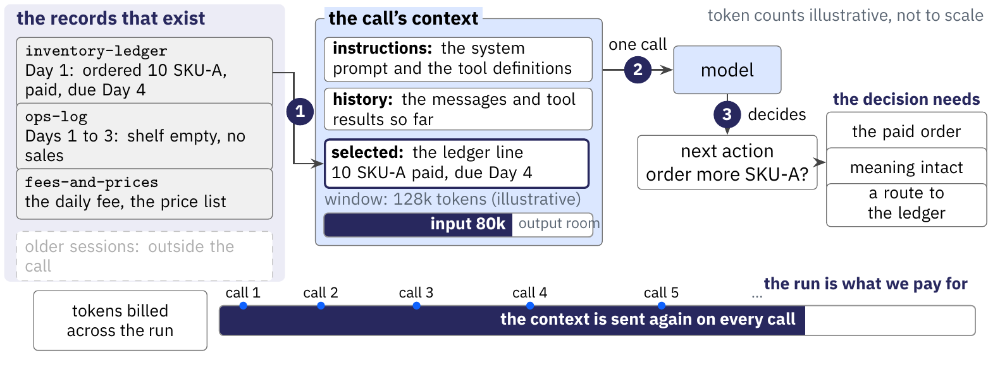
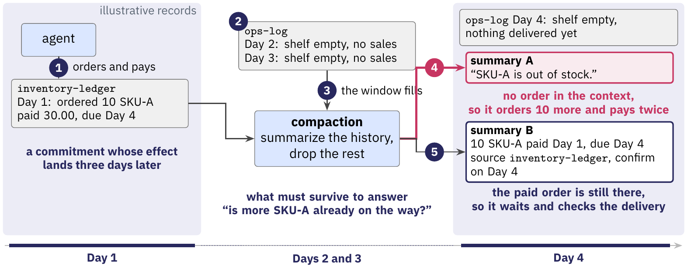

# Part II figure samples, redone in the Lecture 5 and 6 grammar

**Outcome (review 5):** approved with two changes, right-angled connectors with labels in clear space, and reveal and fade notes per click. Revision 5 applies both to all sixteen figures. See the [visual notes](part-02-visuals.md).

The earlier Lecture 7 figures used a separate pale style with sparse boxes. The Lecture 5 and 6 figures use a different grammar. They show a band for a time or a place, and record boxes with real lines. They add numbered events in navy circles, rose for the failure, a navy verdict, and a grey scope note.

Two figures now follow that grammar. Both use the vending teaching case. The remaining figures wait for your answer at the end.

## Reference: Lecture 5, context poisoning

## Sample 1: one call, one slide for Segment 5

This figure merges Slides 5.1 to 5.3 into one slide with three builds.

1. The records that exist, and the call's context built from a selection of them. The meter shows the input and the output room.
2. The call. The model proposes the next action. The right column lists what that decision needs.
3. Across the run. Every call sends the context again, so tokens, time, and charges add up.

Click states: [1](../../slides/figures/context/one-call-1.png), [2](../../slides/figures/context/one-call-2.png), [3](../../slides/figures/context/one-call-3.png). Source: [`one-call.tikz`](../../slides/figures/context/src/one-call.tikz).

## Sample 2: the dropped order, for Segments 8 and 9

This figure carries the teaching case through Slides 8.2, 9.2, and 9.3.

1. Day 1. The agent orders 10 units of SKU-A and pays. The ledger says due Day 4.
2. Days 2 and 3. The shelf stays empty. The window fills, so compaction replaces the history with a summary.
3. Day 4 with summary A. The paid order is gone, so the agent orders 10 more and pays twice.
4. Day 4 with summary B. The paid order, its date, and its source survive. The agent waits and checks the delivery.

Click states: [1](../../slides/figures/context/dropped-order-1.png), [2](../../slides/figures/context/dropped-order-2.png), [3](../../slides/figures/context/dropped-order-3.png), [4](../../slides/figures/context/dropped-order-4.png). Source: [`dropped-order.tikz`](../../slides/figures/context/src/dropped-order.tikz).

## The remaining figures

Each remaining figure gets the same treatment. The plan is 16 figures in place of the 20 sparse ones:

| Figure | Slides | What it shows |
| --- | --- | --- |
| one-call | 5.1 | Sample 1 |
| evidence-position | 6.1 | The same passage at the start, middle, and end of a long input, with the study named |
| context-tasks | 6.2 | Retrieval, tracing, and aggregation on the vending records |
| four-ways | 7.1 | One ledger line, four outputs: retained, retrieved, extracted, rewritten |
| extractive | 7.2, 7.4b | The LLMLingua-2 classifier keeps or drops each token, with a dropped qualifier in rose |
| abstractive | 7.3, 7.4c | A summary replaces the history, with the omitted order in rose |
| recency | 7.4a | The window moves over the days and Day 1 falls out |
| structured-notes | 7.4d | The state card with its open orders |
| delegation | 7.4e | A sub-agent zone that returns one line |
| retrieval | 7.4f | A reference in the context, the store outside, and the fetched record |
| harness-branches | 7.5 | Summary branch, sub-agent, and retry |
| harness-formats | 7.5a to 7.5c | Pi, Claude Code, and Codex summaries with their real section names |
| dropped-order | 8.2, 9.2, 9.3 | Sample 2 |
| compaction-policy | 9.1 | Specify, select, generate, and check, with the return arrow |
| evaluation | 10.1, 10.2 | The five checks over the run, with the stress tests |
| state-bridge | 11.1 | The surviving context inside execution state |

:::question
Redo the remaining figures in this grammar?

The two samples show the style. The remaining 14 figures get the same bands, record boxes, numbered events, rose failures, and navy verdicts. The draft then embeds each final state at full width with its click list.

- [ ] Yes, redo them all this way
- [x] Yes, with the changes in my note
- [ ] No, change the approach first

Recommended: Yes, redo them all this way
:::
