# Part II slide prose — context and compaction (for annotation)

Lecture 7 · November 6, 2026 · **draft for instructor review**

This document contains the text, source notes, and figure instructions for each Part II slide. It follows **structure A (problem-first linear)**.

**Vending-Bench** supplies the example task. The example failure concerns an **outstanding stock order with delayed delivery**. The three main sources are **Lost in the Middle**, **LLMLingua-2**, and **Vending-Bench**. **SWE-bench** supplies further evidence about agent task difficulty.

Plan: [`section-02-plan.md`](section-02-plan.md). Sources: [`part-02-literature.md`](part-02-literature.md).

**Per slide:** use a descriptive title of about 45 characters and list rows with bold labels. **Takeaway** supplies the navy panel sentence. **Notes** supply citations and limits on claims. **Build** describes the figure. Part II uses segment numbers 5–11. Part I uses 1–4.

**Revision 2** applies the [first review](../reviews/part-02-slides-feedback-1.json). It adds a strategy comparison (Slides 7.4–7.5) and the QwenGyre source.

**Revision 3** applies the [second review](../reviews/part-02-slides-feedback-2.json). Segment 7 tables become recaps. Each compaction strategy gets a visual slide (7.4a–f). Slides 7.5a–d describe and group the Pi, Claude Code, and Codex formats. The [harness research note](part-02-harness-compaction.md) supplies their sources.

**Revision 4** applies the [third review](../reviews/part-02-slides-feedback-3.json). The figures reuse the TikZ style and consecutive slide builds from Lectures 4–6. The [visual notes](part-02-visuals.md) identify those sources. Each visual topic now includes its rendered click states and TikZ source.

**Revision 5** applies the [fourth review](../reviews/part-02-slides-feedback-4.json), the [figure review](../reviews/part-02-slides-feedback-5.json), and the [figure rules of review 6](../reviews/part-02-slides-feedback-6.json). Slides 5.1 to 5.3 become one slide with three clicks. The figures now follow the Lecture 5 and 6 grammar: bands, record boxes, numbered events, rose failures, navy verdicts, right-angled connectors. Every Build block states what each click reveals and what it fades.

**Figure-led slides:** the figure carries the example. The prose rows state the teaching points. Keep the figure, the source citation, and the takeaway visible. Place duplicate explanations in speaker notes.

**Click rule:** each click reveals one figure stage. A fade turns an element grey when the run no longer sees it. On the final click, keep the last stage and reveal the navy takeaway panel. Keep the title and the figure position fixed. The two recap tables reveal one row per click, then the takeaway.

---

## Segment 5 — What context must accomplish (0:00–0:03)

### Slide 5.1 — Context supplies each call within a budget
- **Input:** instructions, tools, messages, observations, and selected source material enter one model call. Other records stay outside.
- **Objective:** the next decision needs correct facts, preserved meaning, and a route to the source.
- **Cost:** each call has a capacity limit. Repeated history, summaries, and retrievals add tokens, time, and charges across the run.

**Takeaway.** Context management chooses what each call receives for the next decision within the run budget.

**Notes.** Anthropic's Applied AI team describes context engineering as the selection of tokens for inference. Source: *Effective context engineering for AI agents*, 2025. That article supplies engineering guidance. Pan et al., *LLMLingua-2*, Findings of ACL 2024, §3.1, discusses token reduction, information content, and faithfulness. We add source access as a system-design objective.

Token counts alone do not determine charges. Vendors can charge different rates for caching and other operations. Define a course budget before you compare alternatives. The evaluation segment returns to these objectives. The long-horizon segment uses the distinction between request capacity and run cost.

**Build.** Figure `one-call`, 3 clicks.
1. Reveal the records that exist and the call's context: instructions, history, the selected ledger line, and the window meter.
2. Reveal the call, the next action, and the three things that decision needs.
3. Reveal the run meter: the context goes out again on every call.
4. Keep stage 3 and reveal the takeaway panel.

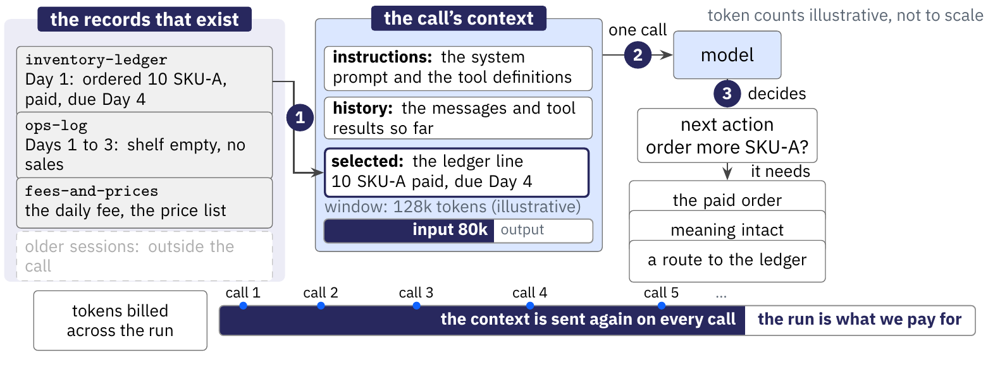

Click states: [1](../../slides/figures/context/one-call-1.png), [2](../../slides/figures/context/one-call-2.png), [3](../../slides/figures/context/one-call-3.png). Source: [`one-call.tikz`](../../slides/figures/context/src/one-call.tikz).

---

## Segment 6 — What long-context experiments show (0:03–0:11)

### Slide 6.1 — Evidence position changes performance
- **Liu et al., TACL 2024:** vary the position of relevant information in multi-document question answering and key-value retrieval.
- **The reported pattern:** performance is often strongest when the relevant information sits near the start or end, and weaker in the middle.
- **The scope:** the finding concerns the models, prompts and tasks evaluated in the study. A present system needs its own measurement.

**Takeaway.** Test where relevant evidence sits in the supplied context.

**Notes.** Nelson F. Liu et al., *Lost in the Middle: How Language Models Use Long Contexts*, TACL 12, 157–173, 2024 (doi:10.1162/tacl_a_00638). One of the three in-depth sources. The open-domain QA case study also separates retriever recall from reader accuracy: added retrieved material need not yield proportional answer gains. Do not generalize its numbers to current models.

**Build.** Figure `evidence-position`, 3 clicks.
1. Reveal the question and the first row: the answer document first, accuracy high.
2. Reveal the middle row: the answer document in the middle, accuracy lowest, in rose.
3. Reveal the last row and the caption: the shape of the finding, with no values.
4. Keep stage 3 and reveal the takeaway panel.

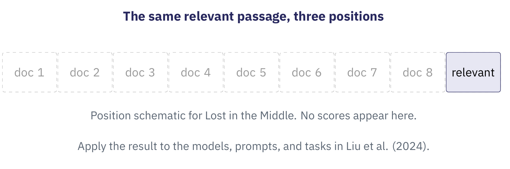

Click states: [1](../../slides/figures/context/evidence-position-1.png), [2](../../slides/figures/context/evidence-position-2.png), [3](../../slides/figures/context/evidence-position-3.png). Source: [`evidence-position.tikz`](../../slides/figures/context/src/evidence-position.tikz).

### Slide 6.2 — Effective context depends on the task
- **Hsieh et al., COLM 2024:** RULER extends simple needle retrieval with multiple needles, variable tracing and aggregation.
- **The reported result:** strong simple-retrieval performance can coexist with degradation on longer or more demanding configurations.
- **The scope:** these synthetic tests apply to the evaluated models. An application needs its own tests.

**Takeaway.** Measure the operations your task needs across the context lengths you expect.

<!-- ste-disable-next-line contraction -->
**Notes.** Cheng-Ping Hsieh et al., *RULER: What's the Real Context Size of Your Long-Context Language Models?*, COLM 2024 (arXiv:2404.06654).

RULER accompanies Lost in the Middle. It reports performance drops as context length grows across its models and tasks. Distinguish the supported input length from measured task performance. RULER measures model context use. It does not evaluate an agent compaction policy.

**Build.** Figure `context-tasks`, 3 clicks.
1. Reveal the retrieval row: one fact in one line.
2. Reveal the tracing row: a chain of three lines.
3. Reveal the aggregation row: every line counts.
4. Keep stage 3 and reveal the takeaway panel.

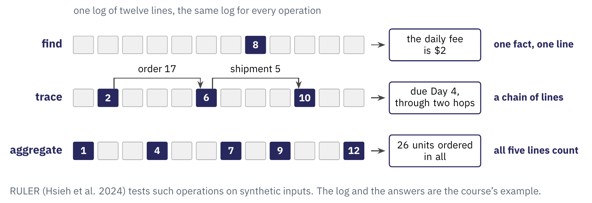

Click states: [1](../../slides/figures/context/context-tasks-1.png), [2](../../slides/figures/context/context-tasks-2.png), [3](../../slides/figures/context/context-tasks-3.png). Source: [`context-tasks.tikz`](../../slides/figures/context/src/context-tasks.tikz).

---

## Segment 7 — Context management: strategies and harness formats (0:11–0:23, tight)

> Review note: this segment grew after review 2. Each compaction strategy now has a visual slide. Tables serve as recaps. Three harness-format slides follow the strategies. The plan records the open timing decision and the option to move slides to backup.

### Slide 7.1 — Four ways to manage context
- **Retain** keeps selected original messages or results.
- **Retrieve** fetches material by query or reference when needed.
- **Compress** keeps only the informative tokens of what stays.
- **Rewrite** replaces a span with a generated summary.

**Takeaway.** A context policy determines what to keep, fetch, shorten, or rewrite.

**Notes.** This four-way split is the course's organizing scheme. Retrieve draws on a large literature, such as RAG (Lewis et al., NeurIPS 2020), kept as supporting reading. The next slides open each way, then compare the compaction strategies one by one.

**Build.** Figure `four-ways`, 4 clicks.
1. Reveal retain: the line as written.
2. Reveal retrieve: a reference in the context and the line in a store. Earlier rows stay.
3. Reveal extract: the informative tokens, with the dropped punctuation in grey.
4. Reveal rewrite: a new sentence, and the note.
5. Keep stage 4 and reveal the takeaway panel.

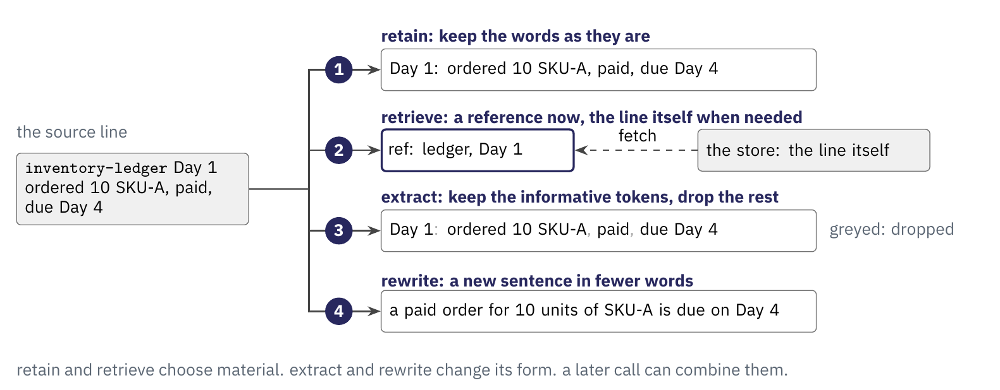

Click states: [1](../../slides/figures/context/four-ways-1.png), [2](../../slides/figures/context/four-ways-2.png), [3](../../slides/figures/context/four-ways-3.png), [4](../../slides/figures/context/four-ways-4.png). Source: [`four-ways.tikz`](../../slides/figures/context/src/four-ways.tikz).

### Slide 7.2 — Extractive compression selects tokens
- **Pan et al., Findings of ACL 2024:** LLMLingua-2 trains a classifier to keep or drop source tokens.
- **The method:** train on an extractive dataset from an LLM. Use context on both sides of each token to decide whether to keep it.
- **The evaluation:** compare compression with task scores and latency on several datasets.
- **The limit:** check whether token deletion preserves the meaning that the task needs.

**Takeaway.** Evaluate the compressed input through the task it must support.

**Notes.** Zhuoshi Pan et al., *LLMLingua-2: Data Distillation for Efficient and Faithful Task-Agnostic Prompt Compression*, Findings of ACL 2024, 963–981 (doi:10.18653/v1/2024.findings-acl.57).

Study this mechanism in depth. Cite **LLMLingua** (Jiang et al., EMNLP 2023) as its origin and LongLLMLingua as its long-context extension. Evaluations include MeetingBank and out-of-domain datasets. The reported gains apply to those test conditions. Do not promise a fixed compression ratio or speed increase.

**Build.** Figure `extractive`, 3 clicks.
1. Reveal the source line as eleven tokens.
2. Reveal the classifier and its label under each token: keep or drop.
3. Reveal the compressed input. The dropped tokens fade in the source row.
4. Keep stage 3 and reveal the takeaway panel.

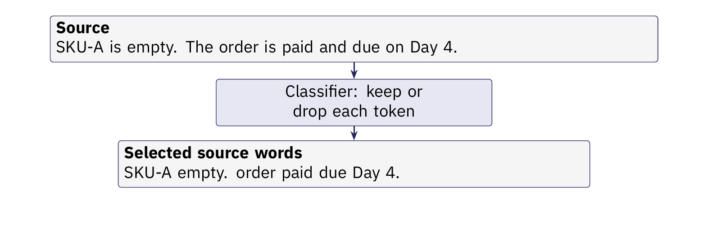

Click states: [1](../../slides/figures/context/extractive-1.png), [2](../../slides/figures/context/extractive-2.png), [3](../../slides/figures/context/extractive-3.png), [4](../../slides/figures/context/extractive-4.png). Source: [`extractive.tikz`](../../slides/figures/context/src/extractive.tikz).

### Slide 7.3 — Abstractive compaction rewrites history
- **Input:** selected conversation history or observations.
- **Transformation:** generate a shorter account of the information the next step needs.
- **Replacement:** assemble later context from that account plus any deliberately retained material.
- **Risk:** omissions and unsupported statements change what the next invocation believes.

**Takeaway.** A generated summary becomes another representation that needs checking.

**Notes.** Anthropic's 2025 article describes a summary that replaces history in a fresh context. Its compaction section warns about excessive loss and recommends tests on complex traces. This is engineering guidance rather than a controlled comparison. The course groups the methods as retain, retrieve, extract, and rewrite. The long-horizon example uses abstractive compaction.

**Build.** Figure `abstractive`, 3 clicks.
1. Reveal the history: five messages, 60k tokens.
2. Reveal the summarizer and its 40-token summary. The history fades.
3. Reveal the next request: system prompt, summary, recent messages.
4. Keep stage 3 and reveal the takeaway panel.

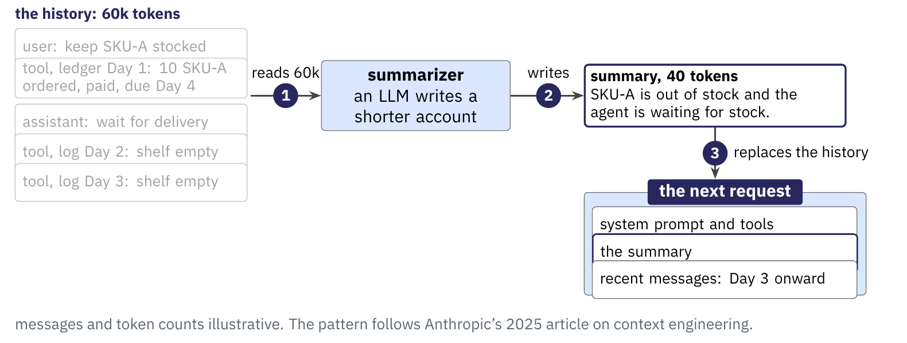

Click states: [1](../../slides/figures/context/abstractive-1.png), [2](../../slides/figures/context/abstractive-2.png), [3](../../slides/figures/context/abstractive-3.png), [4](../../slides/figures/context/abstractive-4.png). Source: [`abstractive.tikz`](../../slides/figures/context/src/abstractive.tikz).

### Slide 7.4a — Recency keeps the last turns
- **How:** keep the most recent turns and drop older ones.
- **Strength:** no extra computation.
- **Failure:** an old but open commitment falls away.

**Takeaway.** Recency is the cheapest strategy and forgets the oldest commitment first.

**Notes.** Every harness falls back on this. Pi keeps a recent window around its summary (Slide 7.5a).

**Build.** Figure `recency`, 3 clicks.
1. Reveal eight turns and the window over the first five.
2. The window moves on: turns 6 and 7 enter, turns 1 and 2 fade.
3. The window moves again: turn 8 enters, turn 3 fades. The rose line names the lost order, the navy line the cost.
4. Keep stage 3 and reveal the takeaway panel.

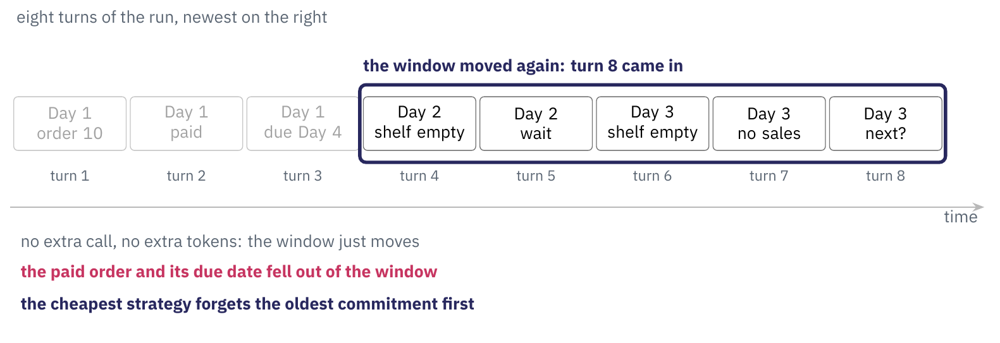

Click states: [1](../../slides/figures/context/recency-1.png), [2](../../slides/figures/context/recency-2.png), [3](../../slides/figures/context/recency-3.png). Source: [`recency.tikz`](../../slides/figures/context/src/recency.tikz).

### Slide 7.4b — Extractive selection keeps key tokens
- **How:** a classifier keeps informative tokens and drops filler.
- **Strength:** cheap and model-agnostic.
- **Failure:** one dropped function word can flip the meaning.

**Takeaway.** Extraction shortens the text and keeps the original words.

**Notes.** LLMLingua-2 (Slide 7.2) is the worked method. The kept tokens read as a terse excerpt of the source.

**Build.** Figure `extractive`, 1 click.
1. Open on stage 3. Reveal stage 4: the rose cross on the dropped word and the navy test line.
2. Keep stage 4 and reveal the takeaway panel.

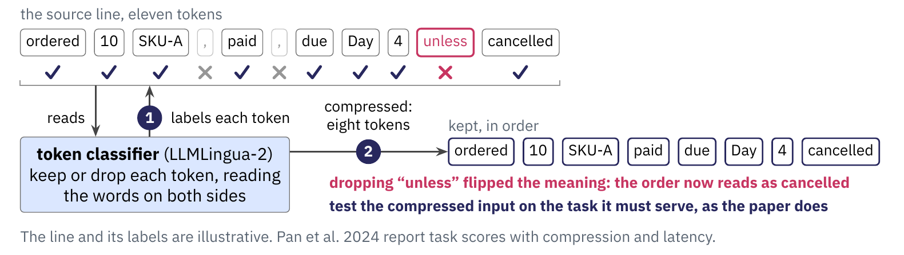

Click states: [1](../../slides/figures/context/extractive-1.png), [2](../../slides/figures/context/extractive-2.png), [3](../../slides/figures/context/extractive-3.png), [4](../../slides/figures/context/extractive-4.png). Source: [`extractive.tikz`](../../slides/figures/context/src/extractive.tikz).

### Slide 7.4c — Abstractive summary rewrites a span
- **How:** an LLM writes a shorter account of a span.
- **Strength:** it preserves meaning flexibly.
- **Failure:** omission and unsupported claims.

**Takeaway.** A summary restates meaning in new words and needs checking.

**Notes.** This is the core of every harness format in Slide 7.5. The summary becomes a new representation to verify.

**Build.** Figure `abstractive`, 1 click.
1. Open on stage 3. Reveal stage 4: the omission in rose and the navy check line.
2. Keep stage 4 and reveal the takeaway panel.

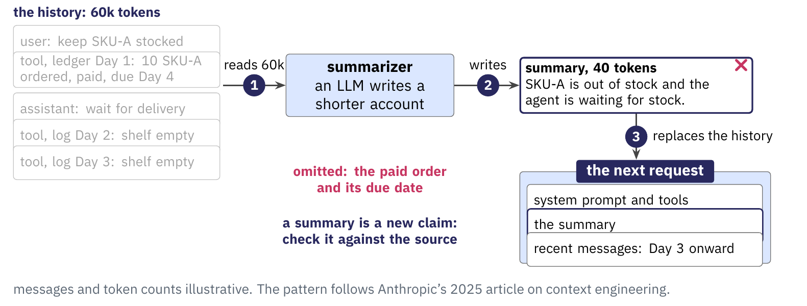

Click states: [1](../../slides/figures/context/abstractive-1.png), [2](../../slides/figures/context/abstractive-2.png), [3](../../slides/figures/context/abstractive-3.png), [4](../../slides/figures/context/abstractive-4.png). Source: [`abstractive.tikz`](../../slides/figures/context/src/abstractive.tikz).

### Slide 7.4d — Structured notes hold a running state
- **How:** keep a schema of goals, open items, and decisions, updated each step.
- **Strength:** commitments persist by design.
- **Failure:** the schema must anticipate what matters.

**Takeaway.** A running state card carries commitments across every compaction.

**Notes.** Pi uses fixed summary sections and file lists as structured notes (Slide 7.5a). Codex also maintains structured notes across sessions (Slide 7.5c).

**Build.** Figure `structured-notes`, 3 clicks.
1. Reveal the card and Day 1: the step writes the open order into the card.
2. Reveal Days 2 and 3: one writes the observations, the other the next check. The order line stays.
3. Reveal the compaction boundary and Day 4, which reads the card. The earlier steps fade. The card stays.
4. Keep stage 3 and reveal the takeaway panel.

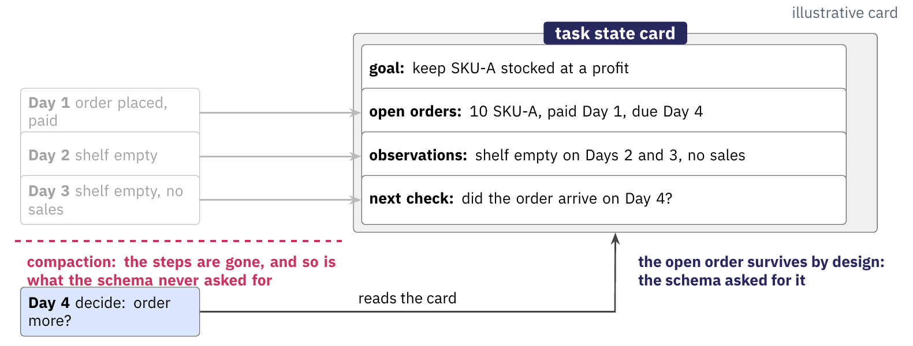

Click states: [1](../../slides/figures/context/structured-notes-1.png), [2](../../slides/figures/context/structured-notes-2.png), [3](../../slides/figures/context/structured-notes-3.png). Source: [`structured-notes.tikz`](../../slides/figures/context/src/structured-notes.tikz).

### Slide 7.4e — Sub-agent delegation isolates a context
- **How:** run a subtask in its own context and return a summary.
- **Strength:** the main context stays small.
- **Failure:** the returned summary is lossy.

**Takeaway.** Delegation moves a subtask's reads out of the main context.

**Notes.** Claude Code uses subagents this way (Slide 7.5b). The main agent sees the result rather than the subtask's reads.

**Build.** Figure `delegation`, 3 clicks.
1. Reveal the main context and the subtask it hands over.
2. Reveal the sub-agent's reads inside its own window.
3. Reveal the one-line result and the two verdict lines.
4. Keep stage 3 and reveal the takeaway panel.

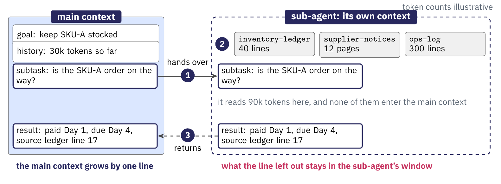

Click states: [1](../../slides/figures/context/delegation-1.png), [2](../../slides/figures/context/delegation-2.png), [3](../../slides/figures/context/delegation-3.png). Source: [`delegation.tikz`](../../slides/figures/context/src/delegation.tikz).

### Slide 7.4f — Retrieval uses history outside the context
- **How:** store history outside and fetch it by reference.
- **Strength:** it scales past any window.
- **Failure:** a query miss or a stale reference.

**Takeaway.** Retrieval trades in-context text for a fetch when needed.

**Notes.** Claude Code's re-read of recent files is a bounded form (Slide 7.5b). The RAG line is the general case.

**Build.** Figure `retrieval`, 3 clicks.
1. Reveal the context with a reference and the store outside the window.
2. Reveal the fetch and the line that comes back.
3. Reveal the stale reference: line 17 changed after a cleanup, in rose.
4. Keep stage 3 and reveal the takeaway panel.

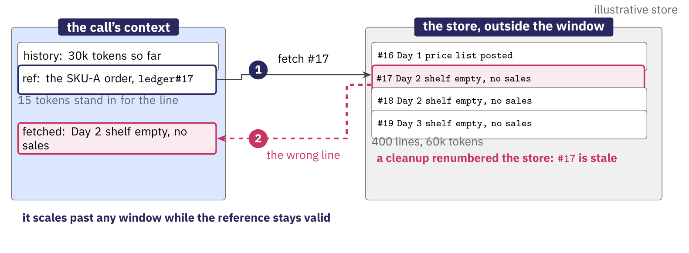

Click states: [1](../../slides/figures/context/retrieval-1.png), [2](../../slides/figures/context/retrieval-2.png), [3](../../slides/figures/context/retrieval-3.png). Source: [`retrieval.tikz`](../../slides/figures/context/src/retrieval.tikz).

### Slide 7.4g — Compaction strategies, compared (recap)
| Strategy | How it works | Strength | Main failure |
| --- | --- | --- | --- |
| Recency / truncation | Keep the last turns, drop older ones | No extra compute | Drops an old but open commitment |
| Extractive selection | Keep the informative tokens (LLMLingua-2) | Cheap, model-agnostic | Lexical choice can shed meaning |
| Abstractive summary | Rewrite a span into a shorter account | Preserves meaning flexibly | Omission and unsupported claims |
| Structured notes | Keep a running state of goals and open items | Commitments persist by design | The schema must anticipate needs |
| Sub-agent delegation | Run a subtask in an isolated context | Keeps the main context small | The returned summary is lossy |
| Retrieve on demand | Store history outside, fetch by reference | Scales past any window | A query miss or a stale reference |

**Takeaway.** Each strategy buys room by giving up a different kind of recall.

**Notes.** Show this recap after the six strategy slides. Contrast these strategies with KV-cache eviction. StreamingLLM (ICLR 2024) and H2O (NeurIPS 2023) reduce cached activations inside the model. They operate at a different layer from changes to the input text.

**Build.** Keep this table as a recap after the six strategy slides. Start with the header. Reveal one strategy row per click. Keep earlier rows visible. Reveal the takeaway after the sixth row.

### Slide 7.5 — Real harnesses compact, delegate, and retry
- **Compact saturated histories:** when the window fills, the harness summarizes the history and continues from the summary.
- **Delegate to sub-agents:** a subtask runs in its own context and returns a summary to the main agent.
- **Retry failed paths:** the harness retries a failed branch, so one task becomes a graph of context paths.
- **The scale:** a single extreme-long run can span hours, hundreds of model–environment interactions, and nearly 1M tokens.

**Takeaway.** At extreme-long horizons, compaction runs continuously and in layers.

**Notes.** Wang et al., *QwenGyre: An Elastic Reinforcement Learning Framework for Training XLong-Horizon Agents*, arXiv:2609.33848, 2026 (Alibaba). Its contribution is RL training infrastructure, and we cite its account of real harnesses. Compaction produces a summary branch that replaces the pre-compaction history, and sub-agents hold separate contexts. Treat the scale as the paper's XLong profile, a very recent report (cites≈0). It bounds these runs, and later systems may differ.

**Build.** Figure `harness-branches`, 3 clicks.
1. Reveal the main trajectory, the compaction point, and the summary branch. The earlier steps show faded.
2. Reveal the sub-agent branch and its one returned result.
3. Reveal the failed path in rose and the retry to step 11.
4. Keep stage 3 and reveal the takeaway panel.

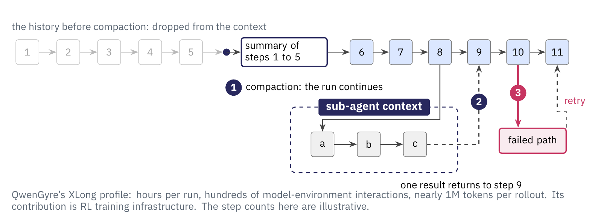

Click states: [1](../../slides/figures/context/harness-branches-1.png), [2](../../slides/figures/context/harness-branches-2.png), [3](../../slides/figures/context/harness-branches-3.png). Source: [`harness-branches.tikz`](../../slides/figures/context/src/harness-branches.tikz).

### Slide 7.5a — Pi compacts into a structured summary
- **Core:** one LLM summary of the old span, with a recent window kept around it.
- **Format:** Goal, Constraints, Progress, Key Decisions, Next Steps, Critical Context.
- **Also:** cumulative file lists carried forward.

**Takeaway.** Pi pairs an abstractive summary with a recent window and structured notes.

**Notes.** Source: Pi `docs/compaction.md`. Automatic compaction starts when token use exceeds the context window minus a reserve of 16384 tokens. The user can also enter `/compact`. This combines Slides 7.4c, 7.4a, and 7.4d. See `part-02-harness-compaction.md`.

**Build.** Figure `harness-formats`, 1 click.
1. Reveal the Pi column: the fixed sections, the recent messages, the file lists.
2. Keep stage 1 and reveal the takeaway panel.

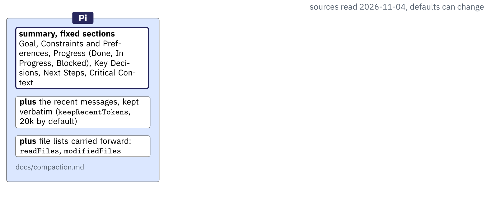

Click states: [1](../../slides/figures/context/harness-formats-1.png), [2](../../slides/figures/context/harness-formats-2.png), [3](../../slides/figures/context/harness-formats-3.png), [4](../../slides/figures/context/harness-formats-4.png). Source: [`harness-formats.tikz`](../../slides/figures/context/src/harness-formats.tikz).

### Slide 7.5b — Claude Code summarizes and re-reads files
- **Core:** the conversation becomes a structured summary.
- **Also:** it re-reads up to five recently touched files.
- **Also:** it adds hook output and skill text again. Subagents keep large reads in separate contexts.

**Takeaway.** Claude Code pairs a summary with a recent-file re-read.

**Notes.** Source: Claude Code docs (context-window). A file over 5000 tokens returns as a path reference. This maps to Slides 7.4c, 7.4f, and 7.4e.

**Build.** Figure `harness-formats`, 1 click.
1. Open on stage 1. Reveal the Claude Code column: the structured summary, the five recent files, the hooks and skills.
2. Keep stage 2 and reveal the takeaway panel.

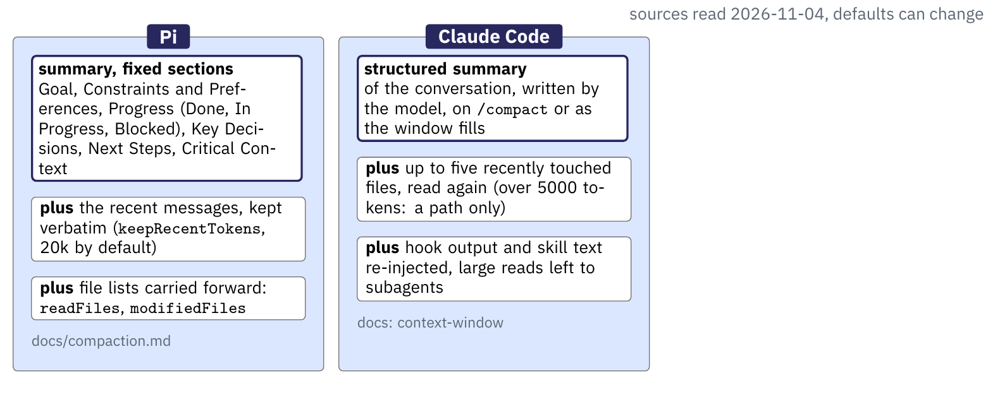

Click states: [1](../../slides/figures/context/harness-formats-1.png), [2](../../slides/figures/context/harness-formats-2.png), [3](../../slides/figures/context/harness-formats-3.png), [4](../../slides/figures/context/harness-formats-4.png). Source: [`harness-formats.tikz`](../../slides/figures/context/src/harness-formats.tikz).

### Slide 7.5c — Codex writes a resumable handoff summary
- **Core:** a context-checkpoint handoff summary for the next model.
- **Also:** it retains the state of tools the previous model used.
- **Also:** it keeps resume metadata and a cross-session memories pipeline.

**Takeaway.** Codex pairs a handoff summary with retained tool state.

**Notes.** Source: openai/codex compact prompt templates. The summary lists progress, decisions, context, next steps, and key references. This maps to Slide 7.4c, selective retain, and Slide 7.4d.

**Build.** Figure `harness-formats`, 1 click.
1. Open on stage 2. Reveal the Codex column: the handoff summary and the retained tool state.
2. Keep stage 3 and reveal the takeaway panel.

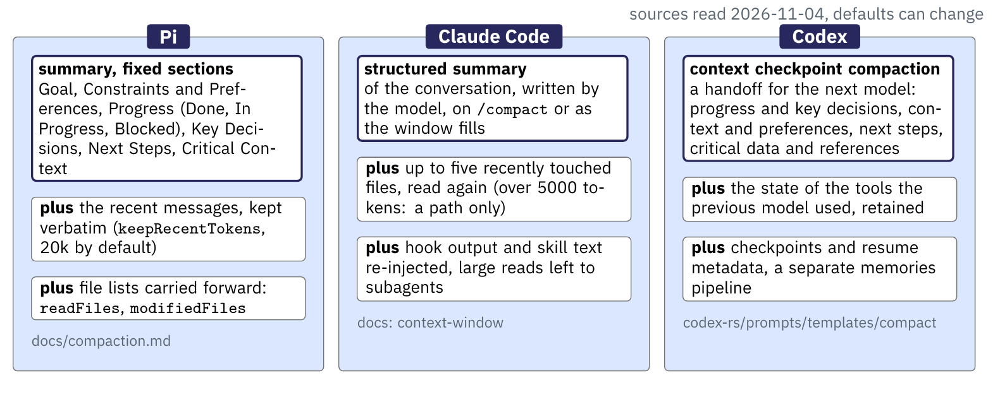

Click states: [1](../../slides/figures/context/harness-formats-1.png), [2](../../slides/figures/context/harness-formats-2.png), [3](../../slides/figures/context/harness-formats-3.png), [4](../../slides/figures/context/harness-formats-4.png). Source: [`harness-formats.tikz`](../../slides/figures/context/src/harness-formats.tikz).

### Slide 7.5d — Three harness formats share one core (recap)
| Harness | Core | Second strategy | Also |
| --- | --- | --- | --- |
| Pi | Abstractive structured summary | Recency window | File lists |
| Claude Code | Abstractive structured summary | Re-read recent files | Hooks, skills, subagents |
| Codex | Abstractive handoff summary | Retain tool outputs | Resume metadata, memories |

**Takeaway.** These three harnesses combine an abstractive summary with other context strategies.

**Notes.** Source: part-02-harness-compaction.md. Pi adds a recent window. Claude Code re-reads files. Codex retains tool state. Show this table as the recap after the three harness slides.

**Build.** Keep this table as a recap after the three harness slides. Start with the header. Reveal Pi, Claude Code, and Codex one row per click. Reveal the takeaway after the third row. Stage 4 of `harness-formats` shows the same recap as a figure, with the three summaries framed in navy.

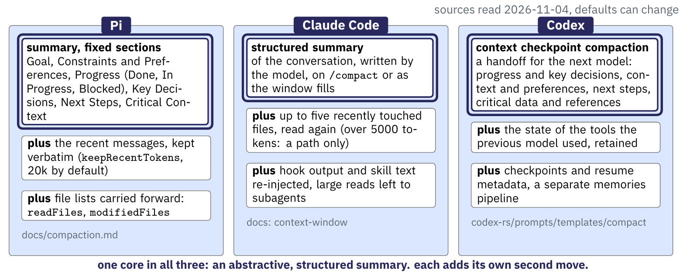

---

## Segment 8 — What a long horizon demands (0:23–0:31)

### Slide 8.1 — Long runs accumulate state to preserve
- **Goals and plans** set what the run is for and how it intends to get there.
- **Progress and pending commitments** record completed work and open promises.
- **Grounded evidence** keeps the observations a later decision will rest on.
- **Replanning triggers** mark when new observations should change the plan.

**Takeaway.** A long run must carry its open commitments forward to act well.

**Notes.** The course combines ideas from two sources. LLM-Planner (Song et al., ICCV 2023) addresses grounded replanning. Anthropic's *Effective harnesses for long-running agents* discusses progress records and verification. QwenGyre supplies the earlier example of extreme-long-horizon scale. The next segments test whether pending commitments survive.

**Build.** Figure `dropped-order`, 1 click.
1. Reveal Day 1: the agent orders and pays, the ledger records the due date, the caption names the commitment.
2. Keep stage 1 and reveal the takeaway panel.

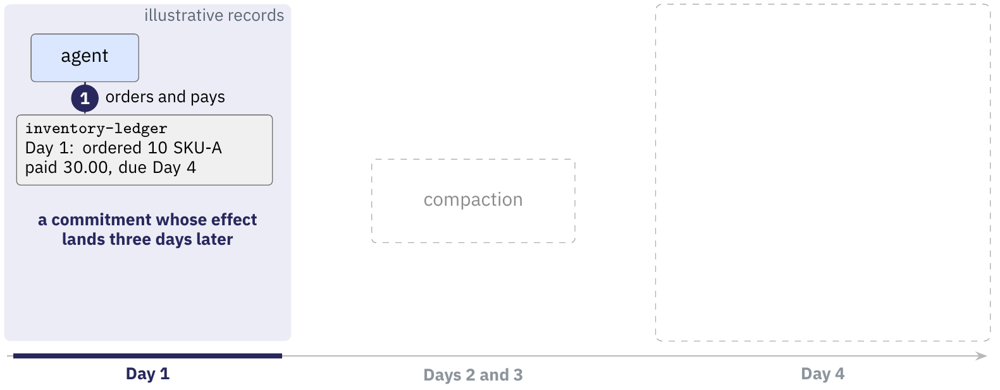

Click states: [1](../../slides/figures/context/dropped-order-1.png), [2](../../slides/figures/context/dropped-order-2.png), [3](../../slides/figures/context/dropped-order-3.png), [4](../../slides/figures/context/dropped-order-4.png). Source: [`dropped-order.tikz`](../../slides/figures/context/src/dropped-order.tikz).

### Slide 8.2 — Vending-Bench stresses long-term coherence
- **The task:** an agent runs a vending-machine business over simulated calendar time — check inventory, order stock, set prices, pay a daily fee.
- **The horizon:** decisions span many simulated days. Orders arrive after a delivery delay. Fees recur.
- **The reported failure:** over long runs, agents can lose long-term coherence — misreading stock and deliveries, and in some runs winding the business down early.
- **Why it fits:** the run's state outgrows one context, so the agent must preserve information between calls.

**Takeaway.** A long run forces a choice about what to carry forward.

**Notes.** Andon Labs, *Vending-Bench: A Benchmark for Long-Term Coherence of Autonomous Agents*, arXiv:2502.15840, 2025. Vending-Bench 2 extends it. Study this task in depth.

Jimenez et al., *SWE-bench*, ICLR 2024 (arXiv:2310.06770), supplies further evidence about difficult agent tasks. It reports low resolve rates on real multi-step tasks. Keep **simulated calendar duration distinct from agent wall-clock runtime and plan depth**. Exact Vending-Bench figures stay in the source paper. Our delayed-delivery case illustrates the paper's type of coherence failure.

**Build.** Figure `dropped-order`, 1 click.
1. Open on Day 1. Reveal Days 2 and 3: the empty shelf, the full window, compaction, and the question.
2. Keep stage 2 and reveal the takeaway panel.

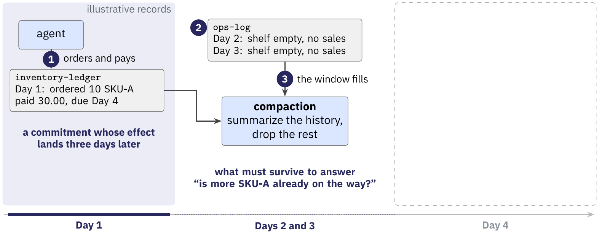

Click states: [1](../../slides/figures/context/dropped-order-1.png), [2](../../slides/figures/context/dropped-order-2.png), [3](../../slides/figures/context/dropped-order-3.png), [4](../../slides/figures/context/dropped-order-4.png). Source: [`dropped-order.tikz`](../../slides/figures/context/src/dropped-order.tikz).

---

## Segment 9 — Compaction as a design procedure (0:31–0:43)

### Slide 9.1 — A compaction policy specifies choices
- **Specify the objective and trigger:** which future tasks must the context support, and when should compaction run?
- **Select the inputs:** identify material to retain verbatim, summarize, or leave available by reference.
- **Generate the replacement:** state facts, decisions, conditions, unresolved questions and source references explicitly.
- **Check and assemble:** check the details the task needs, inspect the resulting request, and measure the total work.

**Takeaway.** Specify what the replacement must preserve before compressing.

**Notes.** The course proposes this procedure from the earlier objectives and mechanisms. Evaluate each policy choice. A token threshold can trigger a check. Task boundaries or new information can also trigger one. Next week covers durable storage and recovery.

**Build.** Figure `compaction-policy`, 4 clicks.
1. Reveal specify: the objective and the trigger.
2. Reveal select: keep, summarize, reference.
3. Reveal generate: the replacement with its facts, open items, and sources.
4. Reveal check and the return path for a failed check.
5. Keep stage 4 and reveal the takeaway panel.

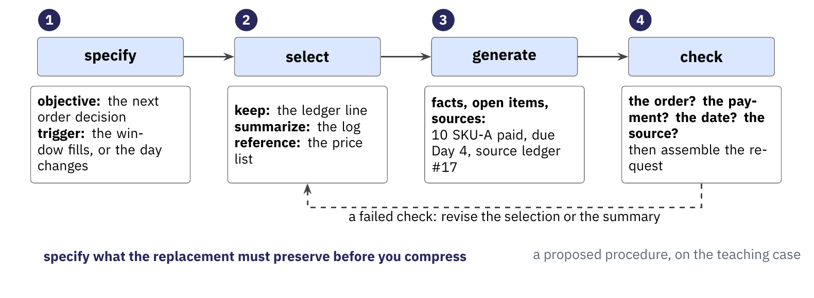

Click states: [1](../../slides/figures/context/compaction-policy-1.png), [2](../../slides/figures/context/compaction-policy-2.png), [3](../../slides/figures/context/compaction-policy-3.png), [4](../../slides/figures/context/compaction-policy-4.png). Source: [`compaction-policy.tikz`](../../slides/figures/context/src/compaction-policy.tikz).

### Slide 9.2 — Compaction must preserve the pending order
**Running example — the Vending-Bench run.** Two records describe SKU-A on Day 3.

- **Order record:** `inventory-ledger` Day 1 records 10 units of SKU-A, payment complete, and delivery expected Day 4.
- **Shelf record:** `ops-log` Days 1–3 records an empty SKU-A shelf and no SKU-A sales.

**Takeaway.** Preserve the open order, its expected arrival, and the debit already paid.

**Notes.** Ask which tokens must survive to answer this question: "Is more SKU-A already on the way?" If compaction keeps only the shelf state, the agent sees an empty shelf without the pending order. It can place a second order and pay twice. It can also conclude that the supplier failed and close the business.

This example illustrates the type of coherence failure in Vending-Bench. The course supplies these records as a teaching case. Keep them beside any summary.

**Build.** Figure `dropped-order`, 1 click.
1. Open on stage 2 and ask the question in the navy line. One click reveals the takeaway.
2. Keep stage 2 and reveal the takeaway panel.

Click states: [1](../../slides/figures/context/dropped-order-1.png), [2](../../slides/figures/context/dropped-order-2.png), [3](../../slides/figures/context/dropped-order-3.png), [4](../../slides/figures/context/dropped-order-4.png). Source: [`dropped-order.tikz`](../../slides/figures/context/src/dropped-order.tikz).

### Slide 9.3 — Compare two compacted representations
- **Candidate A:** "SKU-A is out of stock."
- **Failure:** A loses the paid order and expected arrival. The agent places a second order or closes the business.
- **Candidate B:** "SKU-A shelf-empty Days 1–3. Ordered 10 units on Day 1 (paid), expected Day 4. Sources: `inventory-ledger` Day 1 and `ops-log` Days 1–3. Pending: confirm delivery on Day 4."
- **Preserved commitment:** B keeps the paid order, expected date, and source access.

**Takeaway.** Compare the replacement against the decision it must support.

**Notes.** Both candidates illustrate the teaching case. B is longer because the decision needs the open order. Its references help only while the ledger stays available. A causes the example failure from Segment 8, and B avoids it. Use a build pair in the final deck to show the failure before the fix.

**Build.** Figure `dropped-order`, 2 clicks.
1. Open on stage 2. Reveal summary A and the rose verdict: it orders again and pays twice.
2. Reveal summary B and the navy verdict: it waits and checks the delivery.
3. Keep stage 4 and reveal the takeaway panel.

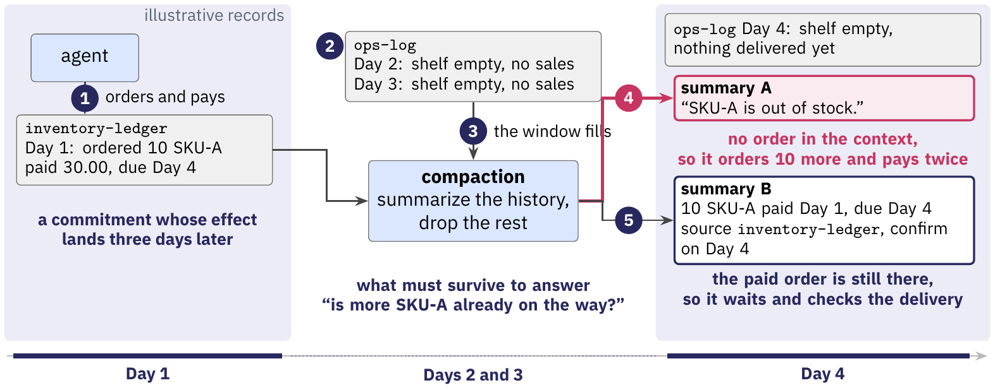

Click states: [1](../../slides/figures/context/dropped-order-1.png), [2](../../slides/figures/context/dropped-order-2.png), [3](../../slides/figures/context/dropped-order-3.png), [4](../../slides/figures/context/dropped-order-4.png). Source: [`dropped-order.tikz`](../../slides/figures/context/src/dropped-order.tikz).

---

## Segment 10 — Evaluating a context policy (0:43–0:48)

### Slide 10.1 — Measure quality and total work
- **Task success:** check the next vending decision.
- **Evidence:** check the facts, conditions, and source references the decision needs.
- **Faithfulness:** check for unsupported claims, changed meaning, and uncertainty that becomes a settled claim.
- **Compression:** measure original and replacement token counts. State the ratio convention.
- **Total work:** count summary calls, retrieval, later model calls, elapsed time, and charges.

**Takeaway.** Compare task quality at a measured total cost.

**Notes.** The course combines these measures. LLMLingua-2 reports task scores, compression, and latency together. Include uncompressed input and a simple selection baseline. Compare equal input budgets where possible, and report uncertainty across repeated runs.

A compression ratio alone cannot show that a policy serves its task. These five measures cover the three objectives from Slide 5.1 and cost.

**Build.** Figure `evaluation`, 5 clicks.
1. Reveal the run lane and check 1: task success.
2. Reveal check 2: evidence.
3. Reveal check 3: faithfulness.
4. Reveal check 4: compression.
5. Reveal check 5: total work.
6. Keep stage 5 and reveal the takeaway panel.

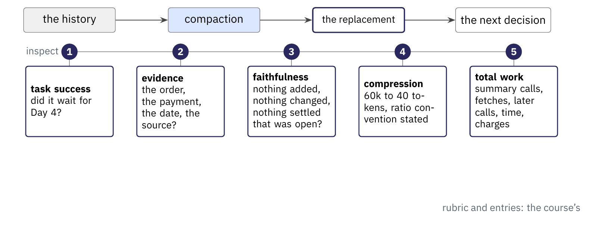

Click states: [1](../../slides/figures/context/evaluation-1.png), [2](../../slides/figures/context/evaluation-2.png), [3](../../slides/figures/context/evaluation-3.png), [4](../../slides/figures/context/evaluation-4.png), [5](../../slides/figures/context/evaluation-5.png), [6](../../slides/figures/context/evaluation-6.png). Source: [`evaluation.tikz`](../../slides/figures/context/src/evaluation.tikz).

### Slide 10.2 — Stress the details compaction can lose
- **Delayed effects:** place an order with delivery after the next compaction. Check that the summary still records the expected arrival.
- **Recurring obligations:** check that the daily fee survives repeated compaction.
- **Updates and provenance:** revise a delivery date. Check that the answer cites the source of that date.
- **Repeated compaction:** check the open order survives several successive replacements.

**Takeaway.** Build tests around the commitments your decisions depend on.

**Notes.** Position and length follow the test logic of Lost in the Middle and RULER. The course proposes the other application tests. Those papers do not report results for these tests.

For the vending run, test an empty shelf while an order remains in transit. Test a second order before the first arrives. Test a delivery notice that changes the expected date. Verify source access separately from summary wording.

**Build.** Figure `evaluation`, 1 click.
1. Open on stage 5. Reveal the four stress tests and the navy line.
2. Keep stage 6 and reveal the takeaway panel.

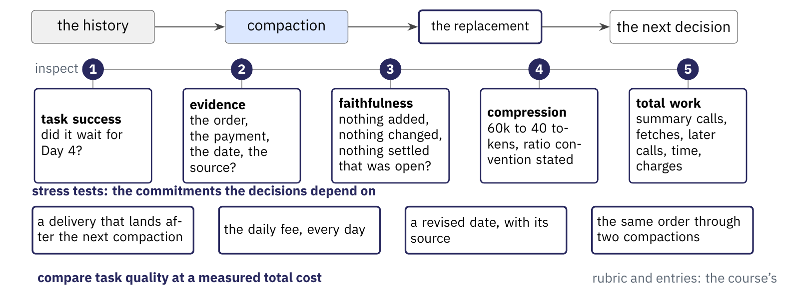

Click states: [1](../../slides/figures/context/evaluation-1.png), [2](../../slides/figures/context/evaluation-2.png), [3](../../slides/figures/context/evaluation-3.png), [4](../../slides/figures/context/evaluation-4.png), [5](../../slides/figures/context/evaluation-5.png), [6](../../slides/figures/context/evaluation-6.png). Source: [`evaluation.tikz`](../../slides/figures/context/src/evaluation.tikz).

---

## Segment 11 — Next week (0:48–0:50)

### Slide 11.1 — Contexts become part of execution state
- **Today:** choose, transform and evaluate what each invocation receives.
- **Next week:** keep these contexts in state to support checkpointing, resumption and replay.

**Takeaway.** The context we construct becomes part of the execution we must preserve.

**Notes.** Connect the context representations to next week, which develops state ownership, run-local and durable state, checkpoint boundaries, resumption and replay. The vending run returns there: its carried-forward commitments are exactly what a checkpoint must hold.

**Build.** Figure `state-bridge`, 2 clicks.
1. Reveal the surviving context and the ghost of the execution state.
2. Reveal the execution state: checkpoints, resume, replay, and the stored context.
3. Keep stage 2 and reveal the takeaway panel.

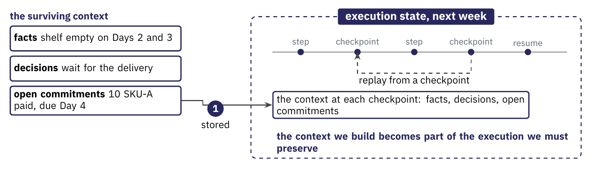

Click states: [1](../../slides/figures/context/state-bridge-1.png), [2](../../slides/figures/context/state-bridge-2.png). Source: [`state-bridge.tikz`](../../slides/figures/context/src/state-bridge.tikz).
