# Part II slide prose — context and compaction (for annotation)

Lecture 7 · November 6, 2026 · **draft for instructor review**

This document contains the text, source notes, and figure instructions for each Part II slide. It follows **structure A (problem-first linear)**.

**Vending-Bench** supplies the example task. The example failure concerns an **outstanding stock order with delayed delivery**. The three main sources are **Lost in the Middle**, **LLMLingua-2**, and **Vending-Bench**. **SWE-bench** supplies further evidence about agent task difficulty.

Plan: [`section-02-plan.md`](section-02-plan.md). Sources: [`part-02-literature.md`](part-02-literature.md).

**Per slide:** use a descriptive title of about 45 characters and list rows with bold labels. **Takeaway** supplies the navy panel sentence. **Notes** supply citations and limits on claims. **Build** describes the figure. Part II uses segment numbers 5–11. Part I uses 1–4.

**Revision 2** applies the [first review](../reviews/part-02-slides-feedback-1.json). It adds a strategy comparison (Slides 7.4–7.5) and the QwenGyre source.

**Revision 3** applies the [second review](../reviews/part-02-slides-feedback-2.json). Segment 7 tables become recaps. Each compaction strategy gets a visual slide (7.4a–f). Slides 7.5a–d describe and group the Pi, Claude Code, and Codex formats. The [harness research note](part-02-harness-compaction.md) supplies their sources.

**Revision 4** applies the [third review](../reviews/part-02-slides-feedback-3.json). The figures reuse the TikZ style and consecutive slide builds from Lectures 4–6. The [visual notes](part-02-visuals.md) identify those sources. Each visual topic now includes its rendered click states and TikZ source.

**Figure-led slides:** the preview contains the diagram labels. The prose rows state the teaching points. Keep the diagram, source citation, and takeaway visible. Place duplicate explanations in speaker notes.

**Click rule:** advance through the numbered figure states. On the final click, keep the last figure state and reveal the navy takeaway panel. Keep the title and figure coordinates fixed. The two recap tables reveal one row per click, then the takeaway.

---

## Segment 5 — What context must accomplish (0:00–0:05)

### Slide 5.1 — Context supplies one model invocation
- **Instructions and tool definitions** describe the task and the available operations.
- **Messages, examples and observations** supply the interaction so far.
- **Selected external material** supplies documents, source text, search results or other evidence.
- **The system assembles this input** before each invocation. Some available information stays outside it.

**Takeaway.** Context management chooses which information reaches each invocation.

**Notes.** Anthropic's Applied AI team describes context engineering as the selection of tokens for inference. Source: *Effective context engineering for AI agents*, 2025. Our list groups its examples for the course. The article supplies engineering guidance. Its broad explanations of attention do not establish results for all models.

**Build.** Use `context-input`.
1. Add instructions and tool definitions.
2. Add messages and observations.
3. Add selected source material.
4. Show the records that stay outside the assembled request.

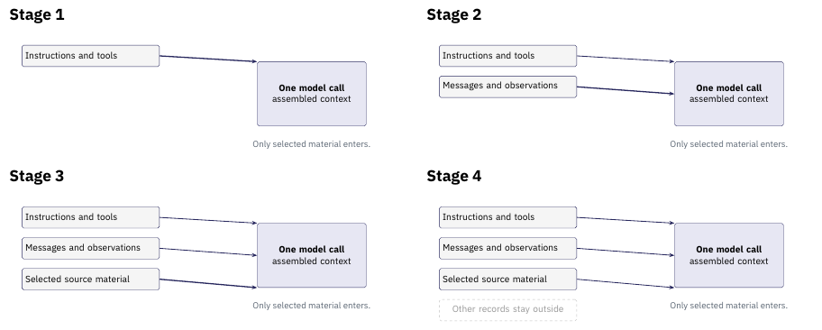

[TikZ source](../../slides/figures/context/src/context-input.tikz) · [Final figure](../../slides/figures/context/context-input-4.png)

### Slide 5.2 — Useful context serves the next task
- **Task quality:** preserve the evidence, constraints and distinctions a sound answer or action needs.
- **Efficiency:** control input length, total token use and elapsed time, including the work of selecting or compressing input.
- **Faithfulness:** keep claims supported and preserve the conditions that change their meaning.
- **Source access:** keep a usable route to source material for later checks.

**Takeaway.** Choose a context policy against explicit task and resource objectives.

**Notes.** The course combines these four objectives. Pan et al., *LLMLingua-2*, Findings of ACL 2024, §3.1, discusses token reduction, information content, and faithfulness. We add source access as a system-design objective. The evaluation segment returns to these objectives.

**Build.** Use `objectives`.
1. Connect task quality to the next decision.
2. Add the resource budget.
3. Add the check for preserved meaning.
4. Add access to the source record.

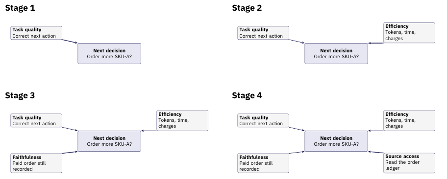

[TikZ source](../../slides/figures/context/src/objectives.tikz) · [Final figure](../../slides/figures/context/objectives-4.png)

### Slide 5.3 — Capacity and cumulative cost differ
- **Context capacity:** one model call must fit its input and leave room for output.
- **Cumulative token use:** repeated history adds tokens across calls. Compression and retrieval also use resources.
- **Time and charges:** measure the complete run, including caching and extra calls.

**Takeaway.** A request can fit while the full run exceeds its budget.

**Notes.** These distinctions do not assume vendor prices. Token counts alone do not determine charges. Vendors can charge different rates for caching and other operations. Define a course budget before you compare alternatives. The long-horizon segment uses this distinction between request capacity and run cost.

**Build.** Use `capacity-cost` in place of the teaching table.
1. Show the input and output space inside one request limit.
2. Add three calls that process history again.
3. Add summary calls, source reads, elapsed time, and charges.

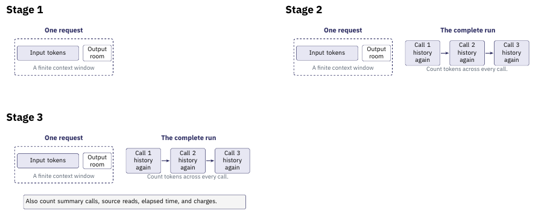

[TikZ source](../../slides/figures/context/src/capacity-cost.tikz) · [Final figure](../../slides/figures/context/capacity-cost-3.png)

---

## Segment 6 — What long-context experiments show (0:05–0:13)

### Slide 6.1 — Evidence position changes performance
- **Liu et al., TACL 2024:** vary the position of relevant information in multi-document question answering and key-value retrieval.
- **The reported pattern:** performance is often strongest when the relevant information sits near the start or end, and weaker in the middle.
- **The scope:** the finding concerns the models, prompts and tasks evaluated in the study. A present system needs its own measurement.

**Takeaway.** Test where relevant evidence sits in the supplied context.

**Notes.** Nelson F. Liu et al., *Lost in the Middle: How Language Models Use Long Contexts*, TACL 12, 157–173, 2024 (doi:10.1162/tacl_a_00638). One of the three in-depth sources. The open-domain QA case study also separates retriever recall from reader accuracy: added retrieved material need not yield proportional answer gains. Do not generalize its numbers to current models.

**Build.** Use `evidence-position`.
1. Place the relevant passage near the start.
2. Move the same passage to the middle.
3. Move it near the end and state the study limits.

The positions illustrate the experiment. Keep the reported pattern in the prose. Do not invent scores or a performance curve.

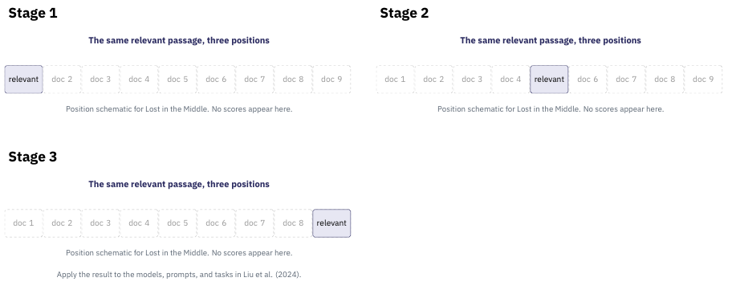

[TikZ source](../../slides/figures/context/src/evidence-position.tikz) · [Final figure](../../slides/figures/context/evidence-position-3.png)

### Slide 6.2 — Effective context depends on the task
- **Hsieh et al., COLM 2024:** RULER extends simple needle retrieval with multiple needles, variable tracing and aggregation.
- **The reported result:** strong simple-retrieval performance can coexist with degradation on longer or more demanding configurations.
- **The scope:** these synthetic tests apply to the evaluated models. An application needs its own tests.

**Takeaway.** Measure the operations your task needs across the context lengths you expect.

<!-- ste-disable-next-line contraction -->
**Notes.** Cheng-Ping Hsieh et al., *RULER: What's the Real Context Size of Your Long-Context Language Models?*, COLM 2024 (arXiv:2404.06654).

RULER accompanies Lost in the Middle. It reports performance drops as context length grows across its models and tasks. Distinguish the supported input length from measured task performance. RULER measures model context use. It does not evaluate an agent compaction policy.

**Build.** Use `context-tasks`.
1. Retrieve a specified fact from a record.
2. Trace a value through assignments.
3. Combine several values into one answer.

Label these as teaching examples. Keep numeric benchmark results in the source paper.

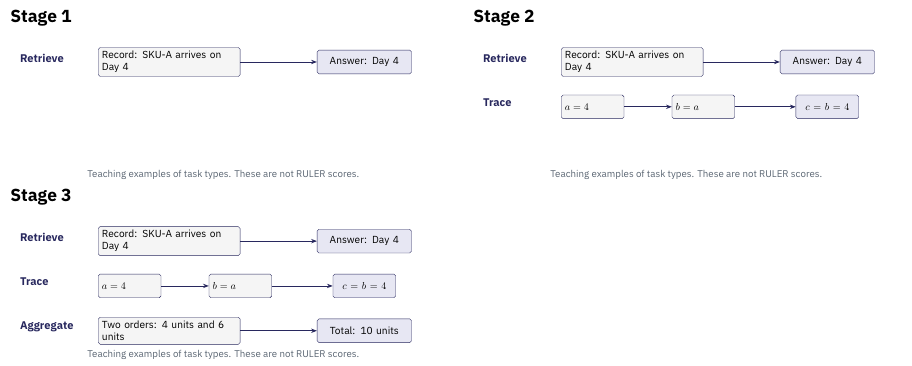

[TikZ source](../../slides/figures/context/src/context-tasks.tikz) · [Final figure](../../slides/figures/context/context-tasks-3.png)

---

## Segment 7 — Context management: strategies and harness formats (0:13–0:26, expanded)

> Review note: this segment grew after review 2. Each compaction strategy now has a visual slide. Tables serve as recaps. Three harness-format slides follow the strategies. The plan records the open timing decision and the option to move slides to backup.

### Slide 7.1 — Four ways to manage context
- **Retain** keeps selected original messages or results.
- **Retrieve** fetches material by query or reference when needed.
- **Compress** keeps only the informative tokens of what stays.
- **Rewrite** replaces a span with a generated summary.

**Takeaway.** A context policy determines what to keep, fetch, shorten, or rewrite.

**Notes.** This four-way split is the course's organizing scheme. Retrieve draws on a large literature, such as RAG (Lewis et al., NeurIPS 2020), kept as supporting reading. The next slides open each way, then compare the compaction strategies one by one.

**Build.** Use `context-choices`.
1. Retain original messages.
2. Fetch a record through a reference.
3. Select tokens from the source.
4. Generate a summary in new words.

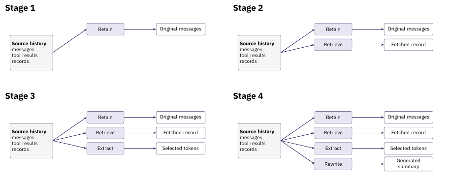

[TikZ source](../../slides/figures/context/src/context-choices.tikz) · [Final figure](../../slides/figures/context/context-choices-4.png)

### Slide 7.2 — Extractive compression selects tokens
- **Pan et al., Findings of ACL 2024:** LLMLingua-2 trains a classifier to keep or drop source tokens.
- **The method:** train on an extractive dataset from an LLM. Use context on both sides of each token to decide whether to keep it.
- **The evaluation:** compare compression with task scores and latency on several datasets.
- **The limit:** check whether token deletion preserves the meaning that the task needs.

**Takeaway.** Evaluate the compressed input through the task it must support.

**Notes.** Zhuoshi Pan et al., *LLMLingua-2: Data Distillation for Efficient and Faithful Task-Agnostic Prompt Compression*, Findings of ACL 2024, 963–981 (doi:10.18653/v1/2024.findings-acl.57).

Study this mechanism in depth. Cite **LLMLingua** (Jiang et al., EMNLP 2023) as its origin and LongLLMLingua as its long-context extension. Evaluations include MeetingBank and out-of-domain datasets. The reported gains apply to those test conditions. Do not promise a fixed compression ratio or speed increase.

**Build.** Use `extractive` for the LLMLingua-2 mechanism.
1. Show the source passage.
2. Add the token classifier.
3. Assemble selected source words.
4. Check whether deletion loses the paid order or due date.

The selection illustrates extraction. It does not reproduce a measured LLMLingua-2 output.

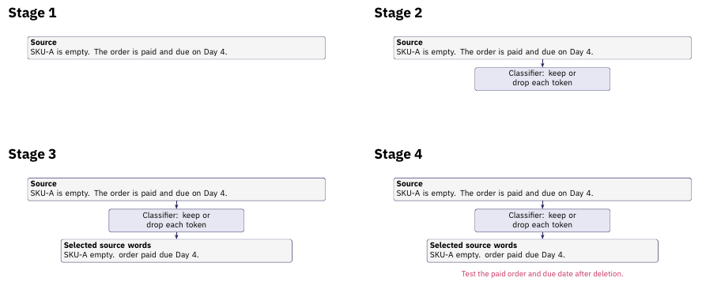

[TikZ source](../../slides/figures/context/src/extractive.tikz) · [Final figure](../../slides/figures/context/extractive-4.png)

### Slide 7.3 — Abstractive compaction rewrites history
- **Input:** selected conversation history or observations.
- **Transformation:** generate a shorter account of the information the next step needs.
- **Replacement:** assemble later context from that account plus any deliberately retained material.
- **Risk:** omissions and unsupported statements change what the next invocation believes.

**Takeaway.** A generated summary becomes another representation that needs checking.

**Notes.** Anthropic's 2025 article describes a summary that replaces history in a fresh context. Its compaction section warns about excessive loss and recommends tests on complex traces. This is engineering guidance rather than a controlled comparison. The course groups the methods as retain, retrieve, extract, and rewrite. The long-horizon example uses abstractive compaction.

**Build.** Use `abstractive`.
1. Show the earlier messages and records.
2. Generate a shorter account in new words.
3. Assemble the next request from the summary and recent messages.
4. Check for omissions and unsupported claims.

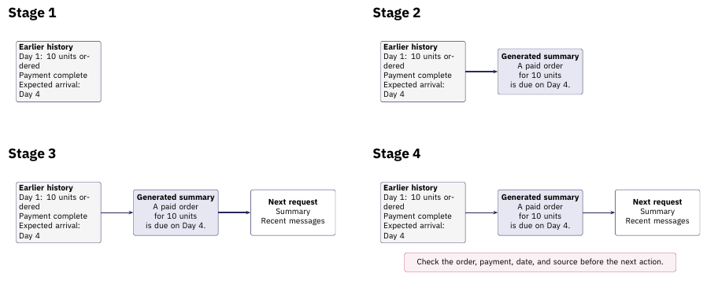

[TikZ source](../../slides/figures/context/src/abstractive.tikz) · [Final figure](../../slides/figures/context/abstractive-4.png)

### Slide 7.4a — Recency keeps the last turns
- **How:** keep the most recent turns and drop older ones.
- **Strength:** no extra computation.
- **Failure:** an old but open commitment falls away.

**Takeaway.** Recency is the cheapest strategy and forgets the oldest commitment first.

**Notes.** Every harness falls back on this. Pi keeps a recent window around its summary (Slide 7.5a).

**Build.** Use `recency`, adapted from Lecture 5's context strip.
1. Show the paid order among the older turns.
2. Retain recent turns and dim the older turns.
3. Remove the older turns and show the lost commitment.

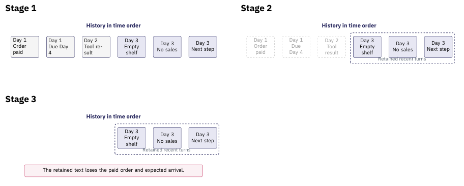

[TikZ source](../../slides/figures/context/src/recency.tikz) · [Final figure](../../slides/figures/context/recency-3.png)

### Slide 7.4b — Extractive selection keeps key tokens
- **How:** a classifier keeps informative tokens and drops filler.
- **Strength:** cheap and model-agnostic.
- **Failure:** lexical choice can drop meaning.

**Takeaway.** Extraction shortens the text and keeps the original words.

**Notes.** LLMLingua-2 (Slide 7.2) is the worked method. The kept tokens read as a terse excerpt of the source.

**Build.** Reuse `extractive` from Slide 7.2.
1. Recall the original passage.
2. Recall the keep-or-drop classifier.
3. Show the retained words.
4. Check the order and due date after deletion.

[TikZ source](../../slides/figures/context/src/extractive.tikz) · [Final figure](../../slides/figures/context/extractive-4.png)

### Slide 7.4c — Abstractive summary rewrites a span
- **How:** an LLM writes a shorter account of a span.
- **Strength:** it preserves meaning flexibly.
- **Failure:** omission and unsupported claims.

**Takeaway.** A summary restates meaning in new words and needs checking.

**Notes.** This is the core of every harness format in Slide 7.5. The summary becomes a new representation to verify.

**Build.** Reuse `abstractive` from Slide 7.3.
1. Recall the earlier history.
2. Generate the summary.
3. Add it to the next request.
4. Check the replacement against its source.

[TikZ source](../../slides/figures/context/src/abstractive.tikz) · [Final figure](../../slides/figures/context/abstractive-4.png)

### Slide 7.4d — Structured notes hold a running state
- **How:** keep a schema of goals, open items, and decisions, updated each step.
- **Strength:** commitments persist by design.
- **Failure:** the schema must anticipate what matters.

**Takeaway.** A running state card carries commitments across every compaction.

**Notes.** Pi uses fixed summary sections and file lists as structured notes (Slide 7.5a). Codex also maintains structured notes across sessions (Slide 7.5c).

**Build.** Use `structured-notes`.
1. Add the task goal.
2. Add the paid order as an open commitment.
3. Record the next delivery check.

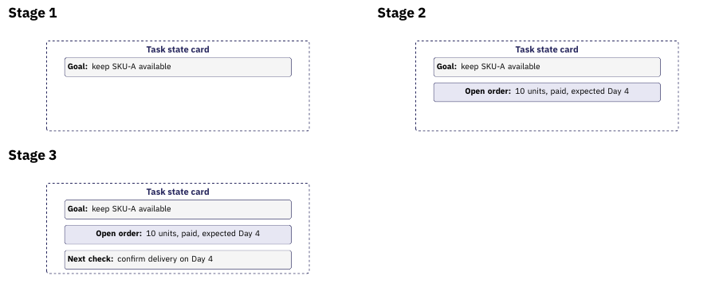

[TikZ source](../../slides/figures/context/src/structured-notes.tikz) · [Final figure](../../slides/figures/context/structured-notes-3.png)

### Slide 7.4e — Sub-agent delegation isolates a context
- **How:** run a subtask in its own context and return a summary.
- **Strength:** the main context stays small.
- **Failure:** the returned summary is lossy.

**Takeaway.** Delegation moves a subtask's reads out of the main context.

**Notes.** Claude Code uses subagents this way (Slide 7.5b). The main agent sees the result rather than the subtask's reads.

**Build.** Use `delegation`, with Lecture 6's separate-context boundaries.
1. Send a subtask from the main context.
2. Keep the ledger and delivery notices inside the sub-agent context.
3. Return a short result to the main agent.

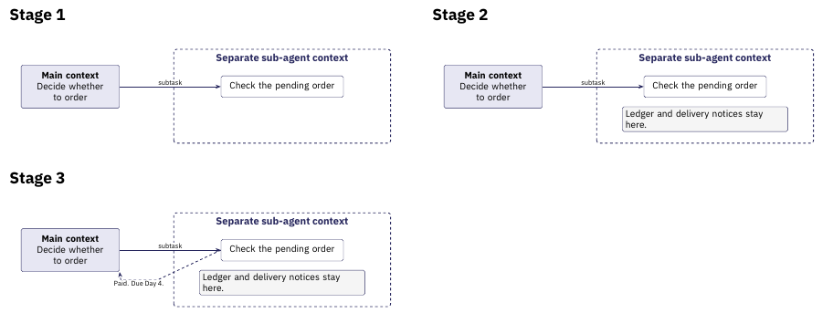

[TikZ source](../../slides/figures/context/src/delegation.tikz) · [Final figure](../../slides/figures/context/delegation-3.png)

### Slide 7.4f — Retrieval uses history outside the context
- **How:** store history outside and fetch it by reference.
- **Strength:** it scales past any window.
- **Failure:** a query miss or a stale reference.

**Takeaway.** Retrieval trades in-context text for a fetch when needed.

**Notes.** Claude Code's re-read of recent files is a bounded form (Slide 7.5b). The RAG line is the general case.

**Build.** Use `retrieval`, with Lecture 4's request and return arrows.
1. Keep a compact reference inside the current context.
2. Fetch its external record.
3. Return the source evidence to the request.

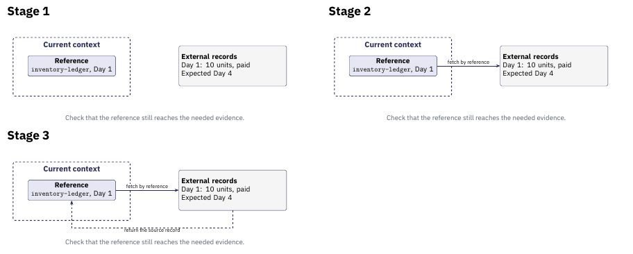

[TikZ source](../../slides/figures/context/src/retrieval.tikz) · [Final figure](../../slides/figures/context/retrieval-3.png)

### Slide 7.4g — Compaction strategies, compared (recap)
| Strategy | How it works | Strength | Main failure |
| --- | --- | --- | --- |
| Recency / truncation | Keep the last turns, drop older ones | No extra compute | Drops an old but open commitment |
| Extractive selection | Keep the informative tokens (LLMLingua-2) | Cheap, model-agnostic | Lexical choice can shed meaning |
| Abstractive summary | Rewrite a span into a shorter account | Preserves meaning flexibly | Omission and unsupported claims |
| Structured notes | Keep a running state of goals and open items | Commitments persist by design | The schema must anticipate needs |
| Sub-agent delegation | Run a subtask in an isolated context | Keeps the main context small | The returned summary is lossy |
| Retrieve on demand | Store history outside, fetch by reference | Scales past any window | A query miss or a stale reference |

**Takeaway.** Each strategy buys room by giving up a different kind of recall.

**Notes.** Show this recap after the six strategy slides. Contrast these strategies with KV-cache eviction. StreamingLLM (ICLR 2024) and H2O (NeurIPS 2023) reduce cached activations inside the model. They operate at a different layer from changes to the input text.

**Build.** Keep this table as a recap after the six strategy slides. Start with the header. Reveal one strategy row per click. Keep earlier rows visible. Reveal the takeaway after the sixth row.

### Slide 7.5 — Real harnesses compact, delegate, and retry
- **Compact saturated histories:** when the window fills, the harness summarizes the history and continues from the summary.
- **Delegate to sub-agents:** a subtask runs in its own context and returns a summary to the main agent.
- **Retry failed paths:** the harness retries a failed branch, so one task becomes a graph of context paths.
- **The scale:** a single extreme-long run can span hours, hundreds of model–environment interactions, and nearly 1M tokens.

**Takeaway.** At extreme-long horizons, compaction runs continuously and in layers.

**Notes.** Wang et al., *QwenGyre: An Elastic Reinforcement Learning Framework for Training XLong-Horizon Agents*, arXiv:2609.33848, 2026 (Alibaba). Its contribution is RL training infrastructure, and we cite its account of real harnesses. Compaction produces a summary branch that replaces the pre-compaction history, and sub-agents hold separate contexts. Treat the scale as the paper's XLong profile, a very recent report (cites≈0). It bounds these runs, and later systems may differ.

**Build.** Use `harness-branches`, adapted from the earlier state graphs.
1. Continue the main run through a summary branch.
2. Add an isolated sub-agent context.
3. Add the failed path and retry.
4. State QwenGyre's reported scale while the final figure stays visible.

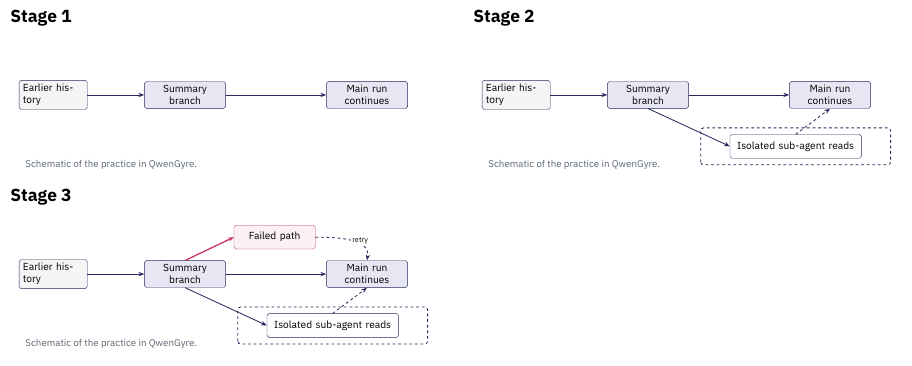

[TikZ source](../../slides/figures/context/src/harness-branches.tikz) · [Final figure](../../slides/figures/context/harness-branches-3.png)

### Slide 7.5a — Pi compacts into a structured summary
- **Core:** one LLM summary of the old span, with a recent window kept around it.
- **Format:** Goal, Constraints, Progress, Key Decisions, Next Steps, Critical Context.
- **Also:** cumulative file lists carried forward.

**Takeaway.** Pi pairs an abstractive summary with a recent window and structured notes.

**Notes.** Source: Pi `docs/compaction.md`. Automatic compaction starts when token use exceeds the context window minus a reserve of 16384 tokens. The user can also enter `/compact`. This combines Slides 7.4c, 7.4a, and 7.4d. See `part-02-harness-compaction.md`.

**Build.** Use `pi-format`.
1. Show the six summary sections.
2. Add the retained recent messages.
3. Add the cumulative file lists.

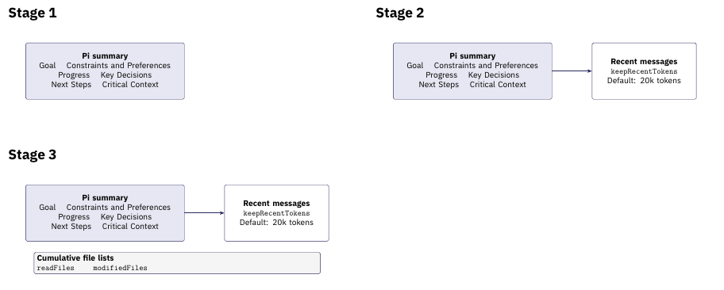

[TikZ source](../../slides/figures/context/src/pi-format.tikz) · [Final figure](../../slides/figures/context/pi-format-3.png)

### Slide 7.5b — Claude Code summarizes and re-reads files
- **Core:** the conversation becomes a structured summary.
- **Also:** it re-reads up to five recently touched files.
- **Also:** it adds hook output and skill text again. Subagents keep large reads in separate contexts.

**Takeaway.** Claude Code pairs a summary with a recent-file re-read.

**Notes.** Source: Claude Code docs (context-window). A file over 5000 tokens returns as a path reference. This maps to Slides 7.4c, 7.4f, and 7.4e.

**Build.** Use `claude-format`.
1. Replace conversation history with the structured summary.
2. Read up to five recent files again.
3. Add hook output and skill text again. Recall the separate sub-agent context from Slide 7.4e.

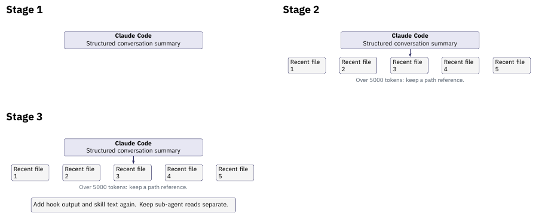

[TikZ source](../../slides/figures/context/src/claude-format.tikz) · [Final figure](../../slides/figures/context/claude-format-3.png)

### Slide 7.5c — Codex writes a resumable handoff summary
- **Core:** a context-checkpoint handoff summary for the next model.
- **Also:** it retains the state of tools the previous model used.
- **Also:** it keeps resume metadata and a cross-session memories pipeline.

**Takeaway.** Codex pairs a handoff summary with retained tool state.

**Notes.** Source: openai/codex compact prompt templates. The summary lists progress, decisions, context, next steps, and key references. This maps to Slide 7.4c, selective retain, and Slide 7.4d.

**Build.** Use `codex-format`.
1. Write the context-checkpoint handoff summary.
2. Add retained tool state and resume metadata.
3. Identify the separate cross-session memories pipeline.

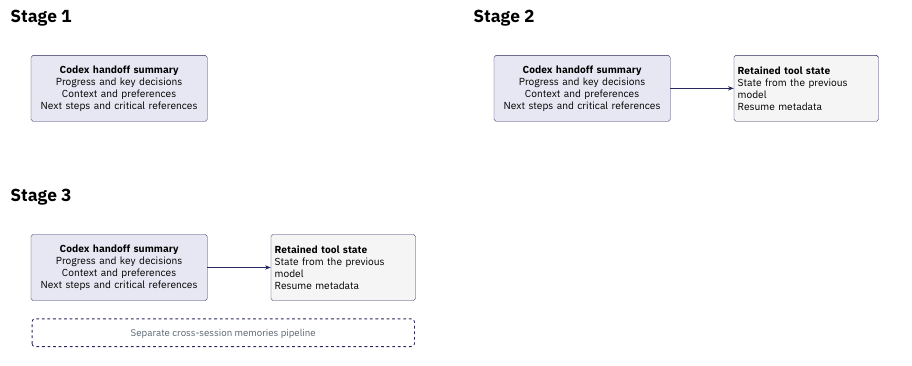

[TikZ source](../../slides/figures/context/src/codex-format.tikz) · [Final figure](../../slides/figures/context/codex-format-3.png)

### Slide 7.5d — Three harness formats share one core (recap)
| Harness | Core | Second strategy | Also |
| --- | --- | --- | --- |
| Pi | Abstractive structured summary | Recency window | File lists |
| Claude Code | Abstractive structured summary | Re-read recent files | Hooks, skills, subagents |
| Codex | Abstractive handoff summary | Retain tool outputs | Resume metadata, memories |

**Takeaway.** These three harnesses combine an abstractive summary with other context strategies.

**Notes.** Source: part-02-harness-compaction.md. Pi adds a recent window. Claude Code re-reads files. Codex retains tool state. Show this table as the recap after the three harness slides.

**Build.** Keep this table as a recap after the three harness slides. Start with the header. Reveal Pi, Claude Code, and Codex one row per click. Reveal the takeaway after the third row.

---

## Segment 8 — What a long horizon demands (0:23–0:31)

### Slide 8.1 — Long runs accumulate state to preserve
- **Goals and plans** set what the run is for and how it intends to get there.
- **Progress and pending commitments** record completed work and open promises.
- **Grounded evidence** keeps the observations a later decision will rest on.
- **Replanning triggers** mark when new observations should change the plan.

**Takeaway.** A long run must carry its open commitments forward to act well.

**Notes.** The course combines ideas from two sources. LLM-Planner (Song et al., ICCV 2023) addresses grounded replanning. Anthropic's *Effective harnesses for long-running agents* discusses progress records and verification. QwenGyre supplies the earlier example of extreme-long-horizon scale. The next segments test whether pending commitments survive.

**Build.** Use `delayed-order` to show what the run must preserve.
1. Place and pay for the Day 1 order.
2. Observe the empty shelf on Days 2 and 3.
3. Move the context boundary past the original order.
4. Carry the open commitment to the Day 4 check.

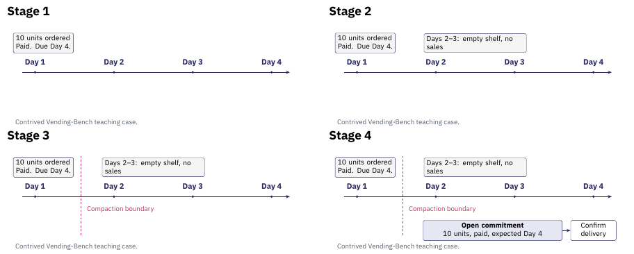

[TikZ source](../../slides/figures/context/src/delayed-order.tikz) · [Final figure](../../slides/figures/context/delayed-order-4.png)

### Slide 8.2 — Vending-Bench stresses long-term coherence
- **The task:** an agent runs a vending-machine business over simulated calendar time — check inventory, order stock, set prices, pay a daily fee.
- **The horizon:** decisions span many simulated days. Orders arrive after a delivery delay. Fees recur.
- **The reported failure:** over long runs, agents can lose long-term coherence — misreading stock and deliveries, and in some runs winding the business down early.
- **Why it fits:** the run's state outgrows one context, so the agent must preserve information between calls.

**Takeaway.** A long run forces a choice about what to carry forward.

**Notes.** Andon Labs, *Vending-Bench: A Benchmark for Long-Term Coherence of Autonomous Agents*, arXiv:2502.15840, 2025. Vending-Bench 2 extends it. Study this task in depth.

Jimenez et al., *SWE-bench*, ICLR 2024 (arXiv:2310.06770), supplies further evidence about difficult agent tasks. It reports low resolve rates on real multi-step tasks. Keep **simulated calendar duration distinct from agent wall-clock runtime and plan depth**. Exact Vending-Bench figures stay in the source paper. Our delayed-delivery case illustrates the paper's type of coherence failure.

**Build.** Reuse `delayed-order` within the Vending-Bench task.
1. Explain the Day 1 stock order and payment.
2. Explain the empty shelf and recurring business costs.
3. Show why the order must survive the context boundary.
4. Identify the expected delivery and next check.

Keep simulated days distinct from wall-clock runtime and plan depth.

[TikZ source](../../slides/figures/context/src/delayed-order.tikz) · [Final figure](../../slides/figures/context/delayed-order-4.png)

---

## Segment 9 — Compaction as a design procedure (0:31–0:43)

### Slide 9.1 — A compaction policy specifies choices
- **Specify the objective and trigger:** which future tasks must the context support, and when should compaction run?
- **Select the inputs:** identify material to retain verbatim, summarize, or leave available by reference.
- **Generate the replacement:** state facts, decisions, conditions, unresolved questions and source references explicitly.
- **Check and assemble:** check the details the task needs, inspect the resulting request, and measure the total work.

**Takeaway.** Specify what the replacement must preserve before compressing.

**Notes.** The course proposes this procedure from the earlier objectives and mechanisms. Evaluate each policy choice. A token threshold can trigger a check. Task boundaries or new information can also trigger one. Next week covers durable storage and recovery.

**Build.** Use `compaction-policy`.
1. Specify the objective and trigger.
2. Select what to keep, summarize, or reference.
3. Generate the replacement context.
4. Check the order, payment, and date. Return to selection or generation if a check fails.

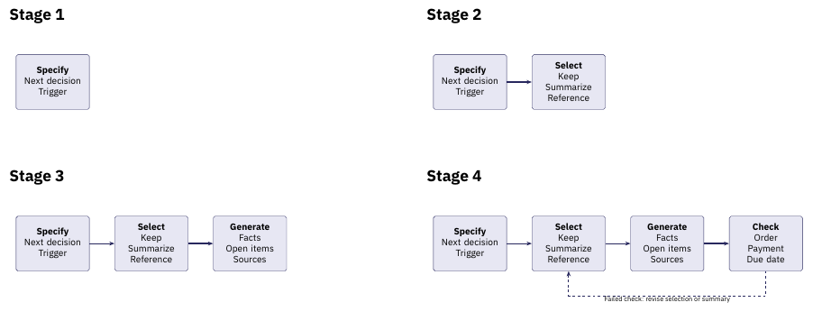

[TikZ source](../../slides/figures/context/src/compaction-policy.tikz) · [Final figure](../../slides/figures/context/compaction-policy-4.png)

### Slide 9.2 — Compaction must preserve the pending order
**Running example — the Vending-Bench run.** Two records describe SKU-A on Day 3.

- **Order record:** `inventory-ledger` Day 1 records 10 units of SKU-A, payment complete, and delivery expected Day 4.
- **Shelf record:** `ops-log` Days 1–3 records an empty SKU-A shelf and no SKU-A sales.

**Takeaway.** Preserve the open order, its expected arrival, and the debit already paid.

**Notes.** Ask which tokens must survive to answer this question: "Is more SKU-A already on the way?" If compaction keeps only the shelf state, the agent sees an empty shelf without the pending order. It can place a second order and pay twice. It can also conclude that the supplier failed and close the business.

This example illustrates the type of coherence failure in Vending-Bench. The course supplies these records as a teaching case. Keep them beside any summary.

**Build.** Reuse `delayed-order` with the two source records beside the timeline.
1. Show the paid Day 1 order from `inventory-ledger`.
2. Add the shelf observations from `ops-log`.
3. Show the compaction boundary.
4. Ask whether more SKU-A is already on the way. Reveal the open order and Day 4 check.

[TikZ source](../../slides/figures/context/src/delayed-order.tikz) · [Final figure](../../slides/figures/context/delayed-order-4.png)

### Slide 9.3 — Compare two compacted representations
- **Candidate A:** "SKU-A is out of stock."
- **Failure:** A loses the paid order and expected arrival. The agent places a second order or closes the business.
- **Candidate B:** "SKU-A shelf-empty Days 1–3. Ordered 10 units on Day 1 (paid), expected Day 4. Sources: `inventory-ledger` Day 1 and `ops-log` Days 1–3. Pending: confirm delivery on Day 4."
- **Preserved commitment:** B keeps the paid order, expected date, and source access.

**Takeaway.** Compare the replacement against the decision it must support.

**Notes.** Both candidates illustrate the teaching case. B is longer because the decision needs the open order. Its references help only while the ledger stays available. A causes the example failure from Segment 8, and B avoids it. Use a build pair in the final deck to show the failure before the fix.

**Build.** Use `replacement-check` with fixed side-by-side positions.
1. Show candidate A beside the original order record.
2. Reveal its duplicate-order failure.
3. Add candidate B and the Day 4 delivery check.

Keep the failure visible while the fix appears. The final click adds only the takeaway.

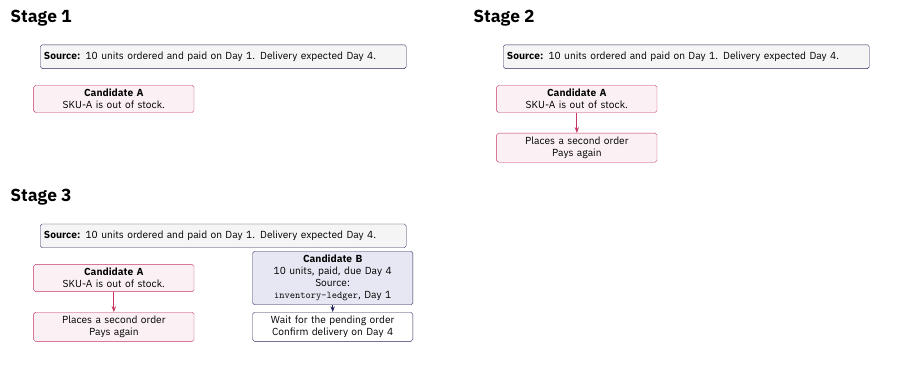

[TikZ source](../../slides/figures/context/src/replacement-check.tikz) · [Final figure](../../slides/figures/context/replacement-check-3.png)

---

## Segment 10 — Evaluating a context policy (0:43–0:48)

### Slide 10.1 — Measure quality and total work
- **Task success:** check the next vending decision.
- **Evidence:** check the facts, conditions, and source references the decision needs.
- **Faithfulness:** check for unsupported claims, changed meaning, and uncertainty that becomes a settled claim.
- **Compression:** measure original and replacement token counts. State the ratio convention.
- **Total work:** count summary calls, retrieval, later model calls, elapsed time, and charges.

**Takeaway.** Compare task quality at a measured total cost.

**Notes.** The course combines these measures. LLMLingua-2 reports task scores, compression, and latency together. Include uncompressed input and a simple selection baseline. Compare equal input budgets where possible, and report uncertainty across repeated runs.

A compression ratio alone cannot show that a policy serves its task. These five measures cover the four objectives from Slide 5.2 and cost.

**Build.** Use `evaluation` in place of the teaching table.
1. Check the next decision.
2. Check facts and source references.
3. Check meaning and unsupported claims.
4. Measure original and replacement token counts.
5. Count the complete run cost.

Keep result values absent until measurements exist. Reveal the takeaway after the fifth check.

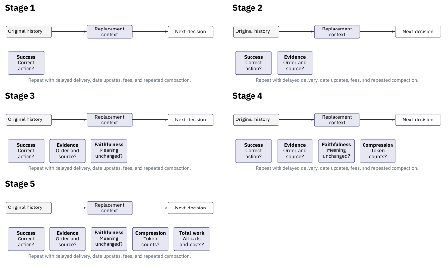

[TikZ source](../../slides/figures/context/src/evaluation.tikz) · [Final figure](../../slides/figures/context/evaluation-5.png)

### Slide 10.2 — Stress the details compaction can lose
- **Delayed effects:** place an order with delivery after the next compaction. Check that the summary still records the expected arrival.
- **Recurring obligations:** check that the daily fee survives repeated compaction.
- **Updates and provenance:** revise a delivery date. Check that the answer cites the source of that date.
- **Repeated compaction:** check the open order survives several successive replacements.

**Takeaway.** Build tests around the commitments your decisions depend on.

**Notes.** Position and length follow the test logic of Lost in the Middle and RULER. The course proposes the other application tests. Those papers do not report results for these tests.

For the vending run, test an empty shelf while an order remains in transit. Test a second order before the first arrives. Test a delivery notice that changes the expected date. Verify source access separately from summary wording.

**Build.** Use `stress-tests`.
1. Carry the paid order through the first compaction.
2. Add the recurring daily fee.
3. Revise the delivery date from a source notice.
4. Check those commitments after another compaction.

Day 5 is a contrived date update for this test.

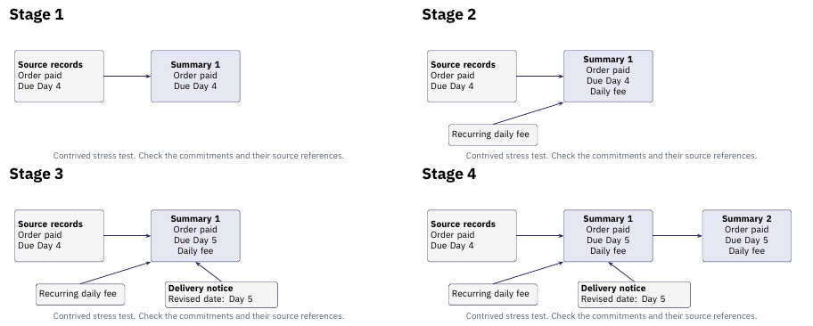

[TikZ source](../../slides/figures/context/src/stress-tests.tikz) · [Final figure](../../slides/figures/context/stress-tests-4.png)

---

## Segment 11 — Next week (0:48–0:50)

### Slide 11.1 — Contexts become part of execution state
- **Today:** choose, transform and evaluate what each invocation receives.
- **Next week:** keep these contexts in state to support checkpointing, resumption and replay.

**Takeaway.** The context we construct becomes part of the execution we must preserve.

**Notes.** Connect the context representations to next week, which develops state ownership, run-local and durable state, checkpoint boundaries, resumption and replay. The vending run returns there: its carried-forward commitments are exactly what a checkpoint must hold.

**Build.** Use `state-bridge` as a short signpost.
1. Identify the context that survives compaction.
2. Place it inside execution state.

Reveal the closing sentence last. Keep the state architecture for next week.

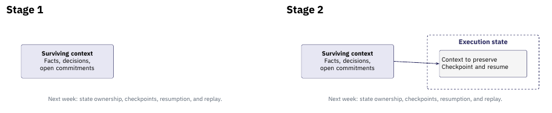

[TikZ source](../../slides/figures/context/src/state-bridge.tikz) · [Final figure](../../slides/figures/context/state-bridge-2.png)
